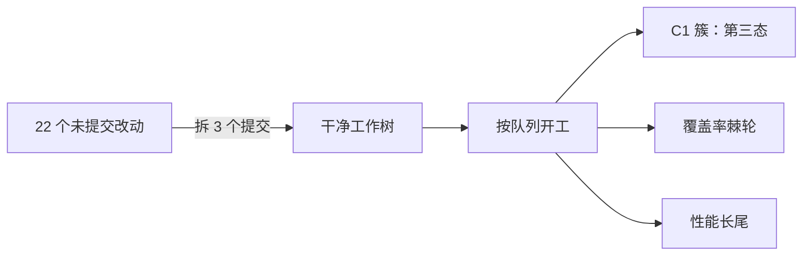

# 收敛计划：从迁移 TODO 到可执行队列（2026-11-23）

**基线**：`main @ b6249b01`，`VERSION 0.38.125.0`，archlint 0.17.1，全量测试 4106 通过
**输入**：`TODO-SUMMARY-BEFORE-WSL.md`、`TODO-WSL-MIGRATION-HANDOVER.md`、
`docs/plans/TODO-2026-11-23-test-speed-supplement.md`，以及迁移后三轮实测

本文**取代**上述三份 TODO 作为执行依据。三份原文保留为历史记录，不再更新——
它们的结论有相当一部分已被迁移后的实测推翻，继续维护会让读者按过期前提做决定。

---

## 0. 先说结论

**环境已就绪，但有一个前置动作没做：22 个未提交改动必须先落库。**

那不是打扫卫生。`check-tools` 重构、WSL `native-path` 修复、`xp-gate-reinstall` 隔离
这三块成果混在同一棵工作树里，开工后任何新改动都会和它们纠缠，`git diff` 失去可读性，
提交也失去边界。这是**开工前唯一必须完成的事**。



---

## 1. 三份 TODO 的现状核对（哪些还成立）

| 原条目 | 迁移后实测 | 结论 |
|---|---|---|
| §6.3 先测 WSL 全量 vitest | **49.5–64.4 s**（Windows 6 分钟未跑完） | ✅ 已完成 |
| §6c / T1「镜像检查快速路径」 | 整脚本 **0.25 s** | ❌ **已失效**：收益前提（进程创建 100–180 ms）在本机是 1–2 ms |
| T2「12 次重复跑脚本」 | 12 × 0.25 s ≈ 3 s | ❌ **已失效**：不是 262 s |
| T3「gate-5-runner-error 待归因」 | 全量套件中未见长尾 | ⏸ 待复测确认 |
| §3.2 `/mnt/c` 污染 | 已根除（PATH / 配置 / 包装脚本三层） | ✅ 已完成 |
| §4 分支/worktree 清理 | 远端仅 5 条分支，本地无多余 worktree | ✅ 无需动作 |
| §6b 覆盖率棘轮 78 → 90 | 门槛仍 78 | ⏳ **未动，仍是你明确的底线要求** |
| §5 issue 归簇（94 个） | 未做 | ⏳ 未动 |
| §8 Quality Gates CI 长期红 | 未复核 | ⏸ 独立问题 |

> **T1/T2 作废这件事值得记住**：它们的收益全部来自"减少进程创建次数"，
> 而前提是每次进程创建 100–180 ms。迁移后实测 1–2 ms，收益缩水两个数量级。
> 一条优化建议的价值绑定在它的测量前提上，前提变了，建议就失效——
> 这正是为什么该先测再优化。

---

## 2. 开工前：必须先把工作树落库（P0）

**判据**：`git status --porcelain` 为空（当前 23 项）。

建议拆成 **3 个提交**，每个独立可回滚、可单独 review：

### 提交 A — `fix(hooks): a native binary must not receive a converted path`

| 文件 | 说明 |
|---|---|
| `githooks/lib/native-path.sh` | WSL 上 Gate 9 **拒绝每次提交**的修复 |
| 对应镜像（由 sync 生成） | — |

**为什么优先**：任何 WSL 贡献者都会遇到——POSIX 路径被转成 `\\wsl.localhost\...`
交给 Linux node，报 `ERR_INVALID_MODULE_SPECIFIER`。已实测 A/B 对比。

⚠️ 合入前把注释里的 `LOCAL PATCH ... re-apply after upgrading` 改掉：
它现在是正式修复，不再是打在本机的补丁。

### 提交 B — `fix(tools): check-tools reports completeness, validity and uniqueness`

| 文件 | 说明 |
|---|---|
| `src/npm-package/lib/tool-audit.js`（新） | 审计核心 |
| `src/npm-package/lib/doctor-tool-checks.js`（新） | doctor 适配层 |
| `src/npm-package/lib/language-tools.js` | 接入审计 |
| `src/npm-package/lib/doctor.js` | 委托 + 去掉阻塞查询 |
| 7 个测试文件（新） | TDD 全红转绿 |
| `package.json` / `package-lock.json` | archlint `^0.17.1` |
| `src/npm-package/lib/__tests__/arch.test.js` | 去掉硬编码版本断言 |
| `scripts/fix-archlint-musl.sh`（新） | WSL glibc 修补 |

**为什么合成一个提交**：`doctor` 委托依赖 `tool-audit`，`arch.test.js` 的修改依赖
archlint 升级。拆开会有中间态测试红。

### 提交 C — `chore(skills): keep xp-gate-reinstall out of the release chain`

| 文件 | 说明 |
|---|---|
| `scripts/check-hook-mirror.sh`、`scripts/__tests__/{skills-mirror-parity,generated-mirror-reproducibility}.test.cjs` | 4 处排除 |
| `plugins/dsh/src/skills.test.ts` + 镜像 | 同上 |

**为什么不并进 B**：与 check-tools 无关，是 skill 分发策略的独立决定。

### 提交 D — 文档

`docs/plans/2026-11-23-wsl-environment-readiness.md`（环境就绪报告）
+ 本文。与代码分开（`docs/AGENTS.md` 的规矩）。

> **不要用目录 pathspec 提交**。实测过：`git commit -- githooks/gate-entries/`
> 会把并发任务未完成的改动一起卷进来。逐个列文件名。

---

## 3. 开工后：按证据排的队列（P1 → P3）

排序依据不是"哪个容易"，而是**哪一项在阻止其他项收敛**。

### P1-A｜覆盖率棘轮 78 → 90（你明确的底线，且是收敛主线）

**为什么排第一**：你自己的判断——"很多次在提升覆盖率的时候就发现了 bug"。
在一个故障高发的阶段，补测试是**唯一同时产出 bug 和防回归**的动作。

| 指标 | 当前门槛 | 迁移前实测 | 目标 |
|---|---|---|---|
| lines | 78 | 78.78 | **90** |
| statements | 78 | 78.78 | 跟随 lines |
| functions | 84 | 84.47 | — |
| branches | 81 | 81.86 | 80（已达标，守住） |

> ✅ **本机实测已取得（2026-11-23）**：
>
> | 指标 | 门槛 | 本机实测 | Windows 侧记录 | 目标 |
> |---|---|---|---|---|
> | lines | 78 | **79.98%** | 78.78% | **90** |
> | statements | 78 | **79.98%** | 78.78% | 跟随 lines |
> | functions | 84 | **85.80%** | 84.47% | — |
> | branches | 81 | **82.16%** | 81.86% | 80（已达标，守住） |
>
> 取得方式：vitest 的 v8 provider **在存在任何失败测试时不写报告**（`coverage/` 里只剩
> `.tmp`；`--coverage.enabled`、改 `reportsDirectory`、关阈值都试过，无效）。用一份临时
> 配置排除 5 个已知失败套件后测得，369 个文件全通过、4063 个测试通过。
> 那份临时配置已删除——**它不是策略变更**。
>
> 通往 90 的起点比 Windows 记录高 1.2 个百分点，但差距仍是约 **10 个百分点**
> （≈ 4900 行未覆盖）。分 85 → 88 → 90 三步仍然成立。

分三步：**85 → 88 → 90**，每步单独提交。

三条硬约束（别踩）：
1. 门槛只在 `vitest.config.ts` 一处，**必须扁平 shape**——vitest 1.6.1 会静默丢弃嵌套
   shape，写成嵌套不报错也不生效（曾出现"在 60% 上声称 80% 门槛、每次提交 exit 0"）。
2. commit 侧覆盖率检查**不许拆掉**。嫌慢就提速，不要拆检查。
3. 补测试要**构造真实边界**，不是凑行数。

### P1-B｜C1 簇「产出层无第三态」（故障高发的直接根源）

45 天 15,387 条门禁记录里 **SKIP 占 10%，其中 35% 没有原因**。
这是"没查"被记成"查了没问题"——本仓库最反复的缺陷族。

**本轮已经修掉两个实例**，可作为范式：
- `psscriptanalyzer` 空输出被判 available（探针假阳性）
- Gate 6 的 GLIBC 加载失败被报成 `BLOCKED - new high+ findings`（失败伪装成判定）

**下一步**：把"SKIP 必须带原因"变成**可执行的检查**，而不是文档里的纪律——
纪律已经存在很久了，35% 的无原因 SKIP 说明靠纪律无效。

### P2｜性能长尾（有证据，但**别先动**）

| 门禁 | 中位 | p90 | max | 下一步 |
|---|---|---|---|---|
| gate-10 | 261 ms | 66 s | 216 s | 先定位触发条件，不要全量优化 |
| gate-12 | 13.9 s | 49.9 s | 143.6 s | 查是否每次全树扫描 |
| gate-5 | 16.7 s | 71.6 s | 289.7 s | 查 `--coverage` 是否恒开（#640） |

**完成判据是 p90 < 30 s、max < 60 s**，不是"中位降 X%"——你感受到的慢是长尾。

> **不要做"减少进程数"类优化**。实测进程创建 1–2 ms，这个方向已经空了（见 §1）。

### P2-b｜issue 归簇

94 个 open issue 逐个修必然修不完（45 天开 181 关 85）。建 C1–C8 标签后**只做 C1 簇**。
C8（设计/索引单）标 `needs-decision` 冻结，不让它稀释信号。

### P3｜清理与收尾 —— **大部分已完成（2026-11-23）**

- ✅ **`gate-7.sh` 副本顺序反了**（提交 `dadafab6`）。
  不是注释差异：adapters 副本先探全局再探项目，而正本已经是项目优先。
  这意味着 `~/.config/xp-gate/adapters/` 会遮蔽项目内适配器——AGENTS.md 警告的
  "stale adapter overrides fresh"，且它改变的是**判定结果**而非仅版本。
- ✅ **`fixture-hygiene` 的 4 处 bats 裸 `git commit`**（提交 `4a202cf4`）。
  其中 `report-persisted-fields.bats` 的修复有讲究：它**必须**让钩子链跑
  （断言的正是钩子写出的报告），所以不能加 `--no-verify`——那会让测试因错误原因通过。
  改为在提交行上显式 pin `-c core.hooksPath="$REPO/githooks"`。
- ✅ **`ac-reference-guard`**（提交 `170f32ec`）。
  我的 58 个 `AC-TOOLS-*` 按决定登记进 `specification.yaml`（17 REQ）；
  另有 56 处既有债务属于 8 个**规范里根本没有 REQ** 的系列（ANT/732/NR/PH/PF/ADR/
  CCNRPT/858），替它们编需求等于伪造历史，故冻结进基线。
- ✅ 环境修复（`/mnt/c` 污染、semgrep、DSH 插件、PATH 包装脚本）——见环境报告。
- ⏳ BATS 分片权重（300/346 套件按 3000 ms 估价）

---

## 4. 已知失败：**5 个文件**（原 9 个，本轮修掉 4 个）

**每个都在 `b6249b01` 的干净 worktree 上复现确认过**，不属于任何本轮改动。

| 测试 | 根因 |
|---|---|
| `language-capability` | csharp 有 2 处未接线（2/2 稳定复现，非 flaky） |
| `gate-10.test.ts` | 待定位 |
| `warnings-baseline-budgets` | 待定位 |
| `execution-surface-contract` | push-only 门禁清单不完整 |
| `pre-push-resolution` | 期望 12 实得 13 |

**本轮已修掉**：`ac-reference-guard`、`adapters-gate-mirror-parity`、`fixture-hygiene`、
`hook-mirror-parity`（后者随 gate-7 修复自动转绿）。

> **别把这 5 个当成本机环境的回归**——它们在你迁移之前就红着。
> 但它们也**阻塞覆盖率测量**：vitest 的 v8 provider 在存在失败测试时不写任何报告。
> 想把覆盖率棘轮做下去，这 5 个必须先清零，或长期维护一份排除配置（后者会让
> 门槛在不知不觉中只对"能过的测试"生效，不建议）。


## 5. 三条如果违反就会白干的纪律

1. **`core.hooksPath` 让本地编辑无效**——改完 `githooks/` 必须
   `xp-gate doctor`，必要时 `xp-gate doctor --sync-hooks`。
2. **编辑正本再 resync 镜像**——`src/npm-package/**` 是构建产物，
   `npm pack` 会覆盖；改 `githooks/`、`plugins/`、`skills/`、`src/<mod>/`。
3. **验证要跑真实执行，不要只看版本号**——本轮 `semgrep --version` 通过而扫描全挂、
   `psscriptanalyzer` 空输出被判 available，都是这个形状。

---

## 6. 现在该做的第一件事

```bash
# 1. 确认工作树状态与本文一致
git status --porcelain        # 应有 23 项

# 2. 按 §2 拆 3 个提交（逐个列文件名，不要用目录 pathspec）

# 3. 提交后确认钩子真的跑了（Gate 5 可能因变更集为空而 SKIP）
git log --oneline -3 && git status --porcelain   # 应为空

# 4. 开始 P1-A：先跑一次覆盖率，拿到本机实测
npx vitest run --coverage        # 记录 lines / branches 实测值
```
